I'm Taimoor Khan, a software engineer specialising in backend services, cloud infrastructure and applied machine learning. I work primarily with .NET and Python, and deploy on Azure with Docker and Kubernetes.

My recent research focuses on computer vision for drone and aerial imagery, including mound detection and missing-mound identification, tree species classification, tree counting and biomass estimation.

For my MSc in Computer Science at the University of South Wales, I developed a deep learning model to forecast water levels on the River Taff for flood risk assessment, delivered through a real-time dashboard with 24-hour predictions.

I'm open to full-time roles and project collaborations. You can reach me through [taimoorkhan.dev](https://taimoorkhan.dev) or [info@taimoorkhan.dev](mailto:info@taimoorkhan.dev).

### What I work with

| | |
|---|---|
| Languages |  |
| Backend |    |
| Frontend |  |
| Mobile |   |
| Data |   |
| Cloud and DevOps |  |
| Machine learning |  |
| Testing |   xUnit, Moq |

### On GitHub

